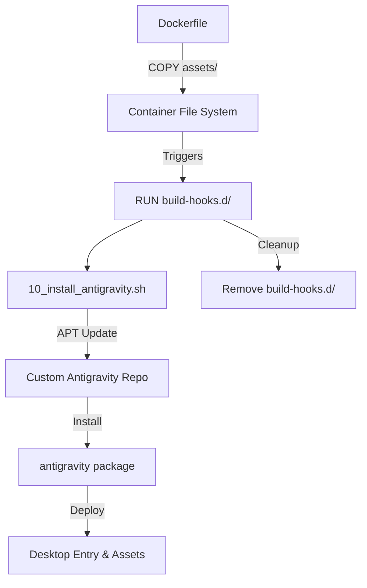

<!--
Copyright 2026 Google LLC

Licensed under the Apache License, Version 2.0 (the "License");
you may not use this file except in compliance with the License.
You may obtain a copy of the License at

    https://www.apache.org/licenses/LICENSE-2.0

Unless required by applicable law or agreed to in writing, software
distributed under the License is distributed on an "AS IS" BASIS,
WITHOUT WARRANTIES OR CONDITIONS OF ANY KIND, either express or implied.
See the License for the specific language governing permissions and
limitations under the License.
-->

# Antigravity Layer Architecture

The **Antigravity Custom Image for Cloud Workstations** provides a specialized environment on top of the GNOME foundation. It is designed to demonstrate how to extend the core blueprint with third-party tools and custom desktop configurations using a declarative, hook-based approach.

## Layer Responsibility

The Antigravity Custom Image for Cloud Workstations focuses on the **Application and Developer Experience** tier. It assumes the underlying OS, systemd, and graphical session are managed by the [GNOME Layer](../../gnome/docs/architecture.md).

| Feature | Responsibility | Integration Method |
| :--- | :--- | :--- |
| **Toolchain** | Installation of specialized packages | Build-time Hooks |
| **Repos** | Custom APT sources management | Asset Injection (`/etc/apt/`) |
| **Desktop UX** | Autostart applications and icons | XDG Autostart & Desktop Files |
| **AI Agent** | Gemini CLI integration | Base Layer Propagation |

## Build-Time Hook Flow

Antigravity utilizes the blueprint's standard hook mechanism to ensure that customizations are applied at the correct stage of the Docker build process without polluting the base image.

### 1. Asset Injection
The Antigravity `Dockerfile` copies its local `assets/` directory directly into the image root. This allows it to:
*   Pre-place repository configuration in `/etc/apt/sources.list.d/`.
*   Prepare build-time scripts in `/build-hooks.d/`.
*   Inject desktop customizations in `/etc/xdg/autostart/`.

### 2. Hook Execution
The `RUN` instruction in the Dockerfile iterates through all scripts in `/build-hooks.d/`. This ensures:
*   **Order of Operations**: Hooks can be sequenced (e.g., `10_...`, `20_...`) if dependencies exist between them.
*   **Isolation**: Each hook runs in its own subshell, and the directory is purged at the end of the layer build to reduce final image size.

## Desktop Session Integration

Once the workstation starts, Antigravity integrates with the GNOME session via standard XDG mechanisms:

1.  **Autostart**: The `antigravity.desktop` file in `/etc/xdg/autostart/` ensures the specialized application launches automatically when the user establishes their RDP session.
2.  **Environment Propagation**: Antigravity inherits all environment variables and systemd services defined in the GNOME layer, ensuring it has access to the ephemeral RDP credentials if needed.

## Cross-Layer Dependencies

*   **GNOME Layer (Parent)**: Provides the Wayland compositor and the Guacamole gateway. Antigravity will fail to start if the GNOME session is not active.
*   **Agent Development Kit (ADK)**: This layer propagates the `INSTALL_AGENT_DEVELOPMENT_KIT_PYTHON` argument to the base layer, ensuring the ADK is present for advanced developer personas.
