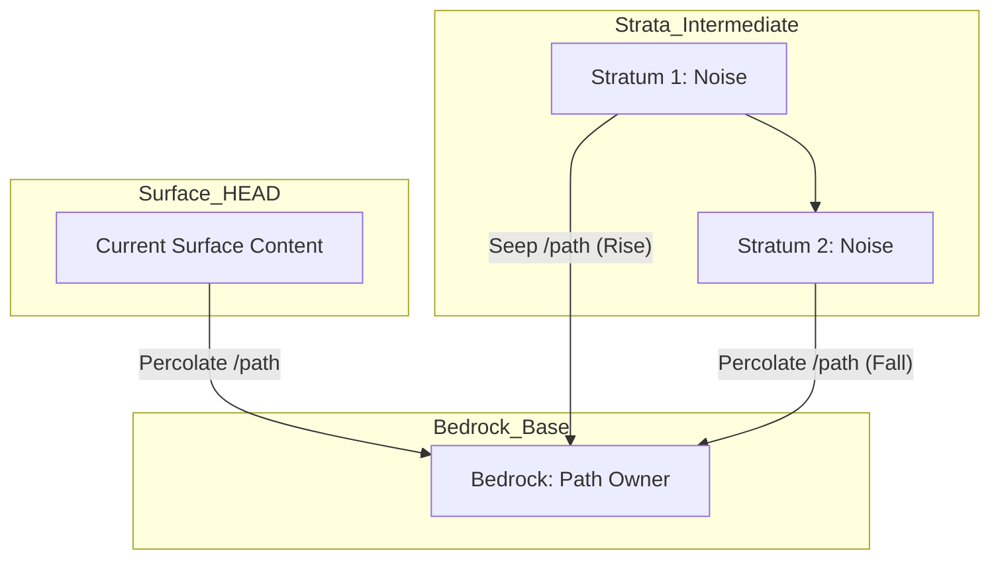

<!--
Copyright 2026 Google LLC

Licensed under the Apache License, Version 2.0 (the "License");
you may not use this file except in compliance with the License.
You may obtain a copy of the License at

    https://www.apache.org/licenses/LICENSE-2.0

Unless required by applicable law or agreed to in writing, software
distributed under the License is distributed on an "AS IS" BASIS,
WITHOUT WARRANTIES OR CONDITIONS OF ANY KIND, either express or implied.
See the License for the specific language governing permissions and
limitations under the License.
-->

# GitSeep: Geological History Percolation

**GitSeep** is a sophisticated history refactoring tool designed for the **persona-swe** skill. It uses a geological analogy to help developers maintain pristine, architecturally sound repository history without the risks and manual toil of complex interactive rebasing.

## 1. The Challenge: Fragmented History
Software development is rarely linear. Clean, small commits are highly preferred for review, testing, and rollback, and "splitting" commits is a common best practice. As developers continue building complex features across multiple layers, they often:
1.  Commit the UI layer.
2.  Commit the Backend layer.
3.  Realize they need to amend an earlier commit (e.g., to expose a hook mechanism or extension point for a later feature).
4.  Commit the fix at the "surface" (HEAD).

**The Result**: Your history becomes a "noisy" timeline where architectural changes are scattered across multiple commits.

Without automation, retroactively sorting these changes is a painful process. However, given an automated approach, developers—and particularly AI agents in an **agentic development workflow**—can simply stay on HEAD, focus entirely on evolving the code, and eventually let GitSeep "sort" all the changes back into the correct historical commits before publishing a perfectly clean history for review.

## 2. Alternative Approaches & Their Limitations
The traditional method for fixing this fragmentation is an **Interactive Rebase** (`git rebase -i`). While powerful, it has significant drawbacks:

*   **Time-Consuming**: You must manually "squash" or "fixup" commits and often re-write commit messages one by one.
*   **Conflict-Prone**: Rebase works by replaying patches. If intermediate commits changed the same files, you must resolve merge conflicts at *every* step where the code diverged.
*   **High Risk**: A mistake during a complex rebase can lead to lost work or a corrupted branch state that is difficult to recover without the `reflog`.

**GitSeep** solves this by using an automated, rule-based approach. By defining exactly which paths belong in which "Bedrock" commit, we save developers from the headache of manual conflict resolution and ensure a predictable, high-integrity result.

## 3. The Ideal Situation
In a perfect repository, every commit is an **atomic, self-contained architectural chapter**. If a commit says "Google Cloud Workstations - GNOME Blueprint," it should contain *all* files and scripts related to that blueprint, regardless of when they were actually written during the development process.

## 4. Geological Analogy & Terminology
GitSeep models your repository history as a **Geological Stack**:

*   **Stratum (plural: Strata)**: An individual commit in your chronological timeline. Each commit is a layer of time.
*   **Surface (HEAD)**: The current state of your code where new logic is initially "poured" or deposited.
*   **Bedrock**: A specific historical Stratum that "owns" an architectural path (e.g., `examples/images/gnome/`). Logic from other strata will eventually settle here.
*   **Percolation**: The downward movement of logic. Changes made at the surface (newer strata) percolate *down* through intermediate layers until they settle into an older Bedrock.
*   **Seepage**: The upward movement or surfacing of logic. A change made deep in the history (e.g., a file introduced too early) "seeps up" through the strata to settle into a *newer* Bedrock commit.
*   **Compression**: When multiple historical versions of the same file exist across different strata. GitSeep "squashes" these into the final surface state when they settle into Bedrock.

### Stratigraphy Visualization


## 5. The Solution: GitSeep Tool
GitSeep automates **Synthetic History Reconstruction**. It rebuilds your branch stratum-by-stratum, ensuring that:
1.  **Bedrock Strata** are updated to include the *final* state of their assigned paths.
2.  **Intermediate Strata** are "filtered" to either pass files down (Percolate) or elevate them up (Seep) to their correct Bedrock.
3.  **Historical Integrity** is preserved (same commit count, same messages, same authorship).

## 6. The Reviewer's Perspective: Why it Matters
From a reviewer's point of view, a fragmented history is a significant burden. Reviewers expect **atomic, self-contained commits** because:

*   **Logical Chunking**: It is much easier to review a single commit that implements a full architectural layer than to chase small fixes across ten different commits.
*   **Reduced Cognitive Load**: When every commit is an atomic "chapter," the reviewer can follow the narrative of the change without mental context-switching.
*   **Traceability**: Self-contained commits make it clear *why* a file was changed in the context of a specific feature, rather than appearing as a mysterious "fix" later in the timeline.

By using GitSeep, you respect your reviewer's time and increase the likelihood of a fast, high-quality approval.

## 7. Benefits
*   **No Rebase Conflicts**: Since it uses "State Projection" (checkout) rather than "Patch Replay" (rebase), you never have to manually resolve merge conflicts.
*   **Colored Change Statistics**: Every commit hash is followed by its change profile (e.g., `[hash] (+2/~1/-1)`), allowing you to quickly gauge the scale of additions, modifications, and deletions.
*   **Single-Key Interaction**: Prompts are responsive and only require a single keypress (no `Enter` required), making the workflow fast and fluid.
*   **1:1 Parity**: It verifies that the final reconstructed history produces a file tree bit-for-bit identical to your original surface.
*   **Safety First**: It is fully interactive by default, requiring confirmation for every stratum.
*   **Stable Identifiers**: It uses Author Dates to find commits, making your rules resilient to hash changes.
*   **Ecosystem Compatibility**:
    *   **Gerrit Workflows**: Ideal for **Android platform developers** and others using Gerrit. It allows you to "trickle down" fixes into the correct Change Sets and Patches without manual re-stacking.
    *   **Remote Synchronization**: Seamlessly works with any Git repository. Use `git push --force-with-lease` to overwrite remote branches with the refined history safely.

## 8. Usage

### Step 1: Survey (Preparation)
Identify your Bedrock commits by viewing the history with ISO dates:
```bash
git log --date=iso
```

### Step 2: Define Permeability Rules
Create a `.gitseep.yaml` file in your repository root. Use `.gitseep.yaml.example` as a template:

```yaml
# Mapping: Bedrock Author Date -> List of owned paths
"2026-04-13 10:01:55 +0000":
  - examples/images/gnome/
```

### Step 3: Run Percolation
```bash
python3 skills/persona-swe/scripts/gitseep.py
```
Alternatively, use high-speed automation (fails on unpermitted compression):
```bash
python3 skills/persona-swe/scripts/gitseep.py --auto-approve --compress
```
Or prepare the history safely on a temporary branch for manual inspection:
```bash
python3 skills/persona-swe/scripts/gitseep.py --stage-only
```

### Step 4: Review Summary & Finalization
Once the script finishes, it will provide a **Seepage Summary Report** detailing exactly how many files were moved, compressed, or established as bedrock. If parity is confirmed and you are not in `--stage-only` mode, approve the finalization to update your branch pointer.

### Step 5: Post-Seepage Validation (Testing)
Because seeping rewrites history, the intermediate commits have fundamentally changed. You **must test every single commit** after seeping to ensure the build isn't broken at any point in the history. This process can easily be automated by running a test script across the modified range (from the earliest base commit up to HEAD). For example, using native Git functionality:
```bash
git rebase --exec "./your_test_script.sh" <earliest_base_commit>^
```

### Step 6: Publishing
The ideal scenario is that you perform all your commits and seeping *before* you publish your work. In this case, you can safely push your clean, refactored history with a standard command:
```bash
git push origin <branch_name>
```

If you have already published your commits, you must "safely overwrite the remote":
```bash
git push --force-with-lease
```
**Important:** As detailed in the Limitations, overwriting remote history is only feasible when using a workflow that expects it (such as pushing to a dedicated **Gerrit** review branch), when branch protection rules do not forbid it, and when collaborators are prepared to deal with rewritten history.

### Step 7: Post-Publishing Hygiene (Deactivate Rules)
Once your refactored code is successfully published and integrated (e.g., your review is merged), you should **delete or comment out the old rules** in your `.gitseep.yaml`. You do not want to rewrite history over and over. Ideally, seeping is performed just once before publishing a feature, ensuring you never need to force-push the same commits repeatedly.

## 9. Command-Line Options

| Option | Description |
| :--- | :--- |
| `--branch <name>` | Target branch name to update (defaults to current branch). |
| `--rules <path>` | Path to the YAML rules file (defaults to `.gitseep.yaml`). |
| `--base <commit>` | The earliest commit to consider for the refactor range (defaults to oldest in rules). |
| `--all-files` | List all files in Bedrock commits (default: only show differences). |
| `--auto-approve` | Skip all confirmations. Fails with code 3 if unpermitted Compression is detected. |
| `--compress` | Automatically allow squashing multiple historical versions of a file. |
| `--stage-only` | Prepare the refactored history on a temporary branch and exit without updating the target branch. |

## 10. Limitations and Assumptions
While powerful, GitSeep operates under specific assumptions and limitations:

*   **File-Level Granularity**: The tool maps rules at the file or directory path level. It assumes that *all* changes to a mapped file belong to a single Bedrock commit. Developers can work freely on HEAD knowing GitSeep will sort the code, *provided* the changes cleanly map by file.
*   **Most Specific Path Wins**: If multiple rules overlap (e.g., one rule for `examples/` and another for `examples/frontend/`), GitSeep automatically processes them by length. The **most specific (longest) path always wins**, allowing you to carve out exceptions within broader directory rules.
*   **Compression Detection**: If a file is modified in multiple strata, GitSeep flags this as **[COMPRESSION]**. In interactive mode, you can type `d` at the prompt to view a `git diff` for each historical version against the final surface state before deciding whether to permit the squash. Alternatively, you must provide the `--compress` flag to authorize it automatically.
*   **Cross-Cutting Changes Overlap**: If you introduce a *new* feature in a later commit that builds upon and modifies the *same files* as an earlier commit, GitSeep will not work as intended for those files. It will move *all* changes within the file to the single Bedrock commit defined for it.
*   **Pre-existing Strata**: Currently, developers must create the base commits (strata) ahead of seeping. The tool requires the logical layers to already exist in the branch history; introducing entirely new commits during the percolation process is not yet supported (but is a viable future enhancement).
*   **The Publishing Boundary**: Seeping rewrites history. It is highly beneficial *until* the commits are published or pushed to a shared collaborative branch (where other developers rely on the history, or where branch protection rules prevent `--force`).
    *   *Exception:* In **Gerrit**, developers push to a dedicated review branch. Until a change is reviewed and submitted, it is fully expected that developers will rewrite history and upload new patches.

## 11. Example Walkthrough
Imagine you have 10 commits. Commit #2 introduced the GNOME Blueprint. You've made 8 more commits, and 3 of them contain minor fixes to the GNOME files.

1.  You add the date of Commit #2 to your `.gitseep.yaml` mapped to `examples/images/gnome/`.
2.  Run `gitseep.py --auto-approve --compress`.
3.  GitSeep rebuilds the branch on a temporary work branch.
4.  When it hits Commit #2 (**Bedrock**), it force-injects the *final* version of the GNOME files from your current HEAD.
5.  When it hits Commits #3 through #10 (**Strata**), it ensures no changes to the GNOME files are introduced there.
6.  **Result**: Your history now shows a single, perfect commit (#2) containing the entire GNOME Blueprint, while your total commit count and messages remain exactly as they were.

## 12. Related Work in the Git Ecosystem
While the Git ecosystem has various tools for history manipulation, GitSeep's approach—**State Projection based on explicit path rules**—occupies a unique niche:

*   **[`git-absorb`](https://github.com/tummychow/git-absorb)**: This Rust-based tool uses heuristics (`git blame`) to guess which recent commit uncommitted lines belong to, creating `fixup!` commits. **Difference**: `git-absorb` guesses based on surrounding code and still requires a conflict-prone interactive rebase afterward. GitSeep uses deterministic architectural rules and bypasses rebase conflicts entirely by reconstructing states.
*   **[`git rebase -i --autosquash`](https://git-scm.com/docs/git-rebase#Documentation/git-rebase.txt---autosquash)**: Native Git functionality that automatically squashes commits created with `git commit --fixup`. **Difference**: This relies entirely on human discipline *during* development. GitSeep allows you to retrospectively and surgically clean up history regardless of how the commits were originally made.
*   **[`git filter-repo`](https://github.com/newren/git-filter-repo)**: The modern standard for massive, repository-wide rewrites (e.g., permanently deleting a sensitive file from all history). **Difference**: `filter-repo` is a blunt instrument. It is not designed for the nuanced, commit-to-commit architectural consolidation ("move all changes to `/frontend` from commits 4-10 back into commit 3") that GitSeep excels at.